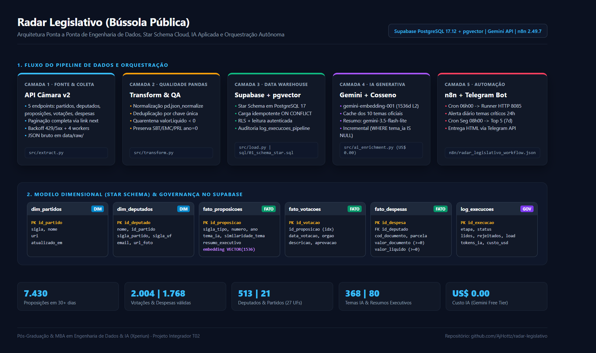
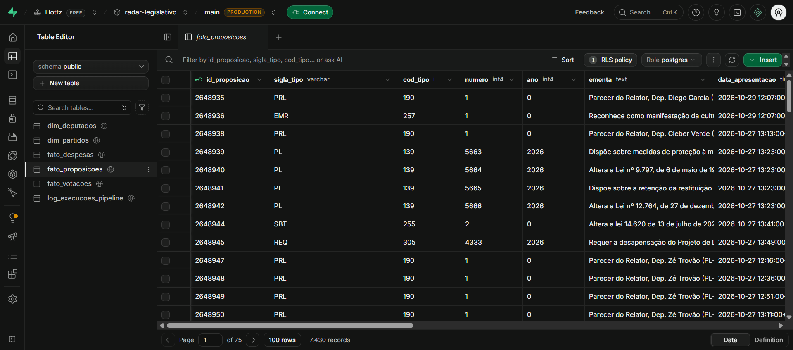
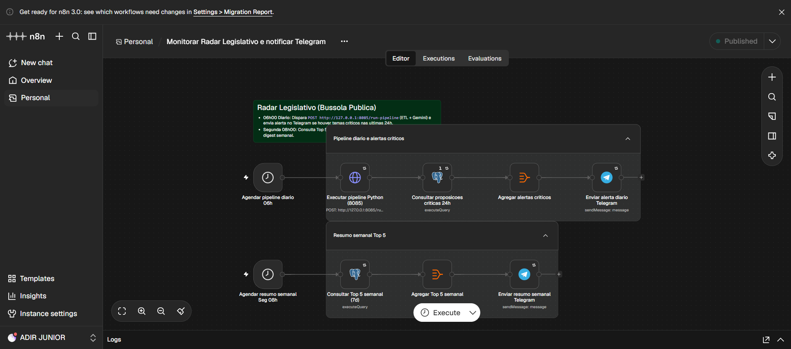
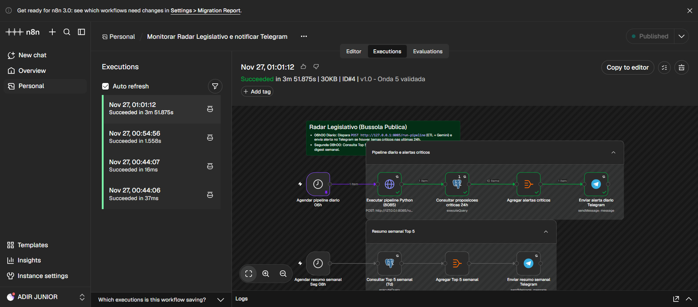
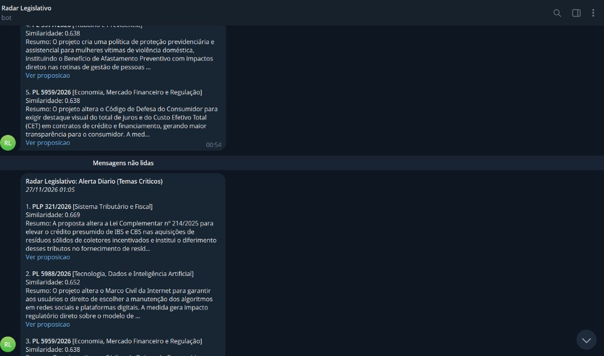

# Radar Legislativo (Bússola Pública)

> Pipeline ponta a ponta de Engenharia de Dados, Modelagem Dimensional, IA Aplicada e Automação para Inteligência Legislativa sobre a API Dados Abertos da Câmara dos Deputados.

---

## 1. Contexto de Negócio

A consultoria **Bússola Pública** entrega inteligência legislativa semanal para escritórios de advocacia, áreas de Relações Governamentais e associações setoriais. Antes deste projeto, a operação sofria com 5 gargalos críticos:

1. Coletas manuais dispersas em planilhas locais.
2. Ausência de histórico estruturado de proposições, votações e despesas.
3. Classificação temática subjetiva e inconsistente entre analistas.
4. Alertas críticos dependentes de memória humana.
5. Falta de visibilidade quantitativa sobre volume legislativo e gastos parlamentares.

O **Radar Legislativo** resolve esses 5 pontos com ingestão resiliente em Python, armazenamento em Data Warehouse dimensional na nuvem (Supabase PostgreSQL 17 + `pgvector`), classificação temática por embeddings com resumo executivo via IA (Gemini Free Tier / OpenAI) e orquestração automatizada no n8n com entregas no Telegram.

---

## 2. Arquitetura do Pipeline



```text
API Camara v2 (/partidos, /deputados, /proposicoes, /votacoes, /despesas)
   |
   v
[Extracao Resiliente - src/extract.py]
   - Paginacao via link rel="next" + retry/backoff exponencial (HTTP 429/5xx)
   - Checkpoint retomavel por deputado + persistencia em data/raw/<entidade>/<data>.json
   |
   v
[Transformacao & Qualidade - src/transform.py]
   - Normalizacao Pandas (pd.json_normalize) + deduplicacao por chave unica
   - Quarentena explicita de despesas negativas (valorLiquido < 0) e validacao de datas
   |
   v
[Data Warehouse Cloud - Supabase PostgreSQL 17.12 + pgvector]
   - Star Schema: dim_partidos, dim_deputados, fato_proposicoes, fato_votacoes, fato_despesas
   - Carga idempotente (INSERT ... ON CONFLICT DO UPDATE) + tabela log_execucoes_pipeline
   |
   v
[Camada de IA - src/ai_enrichment.py]
   - Caminho A: gemini-embedding-001 (1536d L2) ou text-embedding-3-small + cosseno (10 temas em cache)
   - Caminho B: gemini-3.5-flash-lite (ou gpt-4o-mini) para resumo executivo (max 3 linhas)
   |
   v
[Orquestracao n8n - n8n/radar_legislativo_workflow.json + src/webhook_runner.py]
   - Cron diario 06h00 BRT -> Runner HTTP 8085 -> Alerta critico imediato (Telegram HTML)
   - Cron semanal Seg 08h00 BRT -> Digest Top 5 da semana (Telegram HTML)
```

Diagramas Mermaid adicionais em [docs/arquitetura.md](./docs/arquitetura.md).

---

## 3. Modelo Dimensional (Star Schema)

DDL completo e idempotente em [sql/01_schema_star.sql](./sql/01_schema_star.sql) (aplicado no projeto Supabase `radar-legislativo`, `pibefrkcgoplmvkpagda`):

### Visão Geral e Relacionamentos

| Tabela | Tipo | Chave Primária | Relacionamentos | Volume Verificado |
|---|---|---|---|---|
| `dim_partidos` | Dimensão | `id_partido` (`INTEGER`) | Referência lógica por `dim_deputados.id_partido` | `21` |
| `dim_deputados` | Dimensão | `id_deputado` (`INTEGER`) | Pai de `fato_despesas` (`FK id_deputado -> dim_deputados.id_deputado`) | `513` (27 UFs) |
| `fato_proposicoes` | Fato | `id_proposicao` (`BIGINT`) | Referenciada logicamente por `fato_votacoes.id_proposicao` | `7.430` (`368` IA / `80` resumos) |
| `fato_votacoes` | Fato | `id_votacao` (`VARCHAR(100)`) | Referência lógica indexada `id_proposicao` (sem FK bloqueante) | `2.004` |
| `fato_despesas` | Fato | `id_despesa` (`BIGSERIAL`) | `FK id_deputado -> dim_deputados(id_deputado)` + `UNIQUE uq_despesa_doc` | `1.768` |
| `log_execucoes_pipeline` | Governança | `id_execucao` (`BIGSERIAL`) | Auditoria independente de execução ETL e IA | `9` execuções (`US$ 0.00`) |

### Detalhamento das Colunas por Tabela

- **`dim_partidos`:** `id_partido` (PK), `sigla`, `nome`, `uri`, `atualizado_em`.
- **`dim_deputados`:** `id_deputado` (PK), `nome`, `id_partido`, `sigla_partido`, `sigla_uf`, `email`, `url_foto`, `id_legislatura`, `uri`, `atualizado_em` (índices em `sigla_partido` e `sigla_uf`).
- **`fato_proposicoes`:** `id_proposicao` (PK), `sigla_tipo`, `cod_tipo`, `numero`, `ano`, `ementa`, `data_apresentacao`, `uri`, `tema_ia`, `similaridade_tema` (`NUMERIC(6,4)`), `resumo_executivo`, `embedding` (`VECTOR(1536)`), `processado_ia_em`, `atualizado_em` (índices em `data_apresentacao DESC` e `tema_ia`).
- **`fato_votacoes`:** `id_votacao` (PK), `id_proposicao`, `proposicao_objeto`, `uri_proposicao_objeto`, `data_votacao`, `data_hora_registro`, `sigla_orgao`, `descricao`, `aprovacao`, `uri`, `atualizado_em` (índices em `data_hora_registro DESC` e `id_proposicao`).
- **`fato_despesas`:** `id_despesa` (PK), `id_deputado` (FK -> `dim_deputados`), `ano`, `mes`, `tipo_despesa`, `tipo_documento`, `cod_documento`, `num_documento`, `data_documento`, `nome_fornecedor`, `cnpj_cpf_fornecedor`, `valor_documento` (`CHECK >= 0`), `valor_liquido` (`CHECK >= 0`), `valor_glosa` (`CHECK >= 0`), `parcela`, `url_documento`, `atualizado_em` + `UNIQUE (id_deputado, cod_documento, num_documento, parcela, valor_liquido)`.
- **`log_execucoes_pipeline`:** `id_execucao` (PK), `etapa`, `janela_dias`, `registros_lidos`, `registros_rejeitados`, `registros_carregados`, `tokens_ia`, `custo_estimado_usd`, `status`, `detalhes` (`JSONB`), `executado_em`.

---

## 4. Decisões Técnicas, Descobertas da API e Porquês

1. **Por que Star Schema em PostgreSQL + `pgvector` (Supabase) em vez de arquivos locais ou banco puramente vetorial:**
   - Separa dimensões cadastrais (`dim_partidos`, `dim_deputados`) das tabelas transacionais (`fato_proposicoes`, `fato_votacoes`, `fato_despesas`), viabilizando tanto agregações analíticas via SQL/BI quanto busca semântica via `VECTOR(1536)` no mesmo banco gerenciado.
2. **Por que classificar os 10 temas via embeddings + similaridade de cosseno antes do LLM:**
   - Classificar via prompt livre de LLM para cada item seria mais lento, mais caro e sujeito a variação de rótulos. Vetorizando os 10 temas oficiais uma única vez em cache local ([data/cache/temas_embeddings.json](./data/cache/temas_embeddings.json)), a classificação é determinística, padronizada e tem custo quase zero por lote.
3. **Por que adotar Gemini API Free Tier com suporte dual-provider para OpenAI (`src/ai_enrichment.py`):**
   - Mantivemos compatibilidade com OpenAI (`text-embedding-3-small` + `gpt-4o-mini`) e implementamos o provedor Gemini (`gemini-embedding-001` reduzido e normalizado L2 para 1.536 dimensões + `gemini-3.5-flash-lite` com fallback e retry para `HTTP 429`), permitindo processar `368` proposições e `80` resumos executivos a **US$ 0.00**.
4. **Por que `fato_votacoes.id_proposicao` não tem `FOREIGN KEY` rígida para `fato_proposicoes`:**
   - Na exploração prévia (`src/explore.py` e `notebooks/01_exploracao_api.ipynb`), descobrimos que votações atuais frequentemente referenciam proposições protocoladas em anos anteriores fora da janela de 30 dias. A coluna permanece indexada para `JOIN`, evitando falhas de integridade na carga incremental.
5. **Por que preservar proposições com `ano = 0` e colocar despesas negativas em quarentena explícita:**
   - Emendas e substitutivos (`SBT`, `EMC`, `PRL`) retornam `ano = 0` na API oficial; descartá-los perderia movimentação relevante. Já em despesas CEAP, `18.387` registros de `valorLiquido < 0` (estornos/bilhetes cancelados) são retidos em quarentena (`data/cache/quarantine_despesas_*.json`) antes da carga para proteger as somas analíticas e a constraint `CHECK (valor_liquido >= 0)`.
6. **Por que `ThreadPoolExecutor`, JSON bruto em `data/raw/`, Session Pooler IPv4 e `--dns-result-order=ipv4first`:**
   - `/deputados/{id}/despesas` impõe rate limit (`429`) sob concorrência: persistir JSON bruto antes da transformação garante reprocessamento offline sem nova coleta. No Windows sem rota IPv6 externa, o Session Pooler IPv4 (`aws-0-sa-east-1.pooler.supabase.com:5432`) e `NODE_OPTIONS="--dns-result-order=ipv4first"` garantem estabilidade para Postgres e Telegram API.

---

## 5. Camada de IA e Prompts Utilizados

- **Taxonomia Oficial (10 Temas):** Saúde Pública; Sistema Tributário e Fiscal; Trabalho e Previdência; Tecnologia, Dados e Inteligência Artificial; Meio Ambiente, Energia e Clima; Economia, Mercado Financeiro e Regulação; Segurança Pública e Justiça; Educação, Ciência e Cultura; Infraestrutura, Transportes e Cidades; Agronegócio e Desenvolvimento Regional.
- **System Prompt (`SUMMARY_SYSTEM_PROMPT` em [src/ai_enrichment.py](./src/ai_enrichment.py#L43-L51)):**
  > "Voce e um analista senior de inteligencia legislativa da consultoria Bussola Publica. Baseie-se EXCLUSIVAMENTE na ementa oficial informada. Nunca invente ou suponha o merito de um projeto citado apenas por numero. Se a ementa for puramente procedimental (sem descrever o merito da materia), responda em 1 frase objetiva informando que se trata de tramite/parecer sem merito detalhado na ementa. Caso haja merito descrito, resuma em NO MAXIMO 3 linhas corridas (sem titulo nem markdown excessivo), em portugues claro de negocios, destacando impacto regulatorio, setor afetado e risco ou oportunidade para empresas."
- **User Prompt (`user_prompt` em [src/ai_enrichment.py](./src/ai_enrichment.py#L230-L234)):**
  ```text
  Proposicao: {sigla_tipo} {numero}/{ano}
  Tema classificado: {tema_ia}
  Ementa oficial: {ementa}
  ```
- **Governança de Custos:** Seleção incremental apenas onde `tema_ia IS NULL` (priorizando `PL`, `PLP`, `PEC` e `MPV`), piloto obrigatório com `--limit 10` e auditoria em `log_execucoes_pipeline`. Total acumulado no projeto: **368 classificações** e **80 resumos executivos** a custo **US$ 0.00**.

---

## 6. Evidências do Banco (Supabase) e Automação (n8n + Telegram)

### Data Warehouse no Supabase (`7.430` registros em `fato_proposicoes`, RLS ativo e 6 tabelas)


### Canvas do Workflow Publicado (`Pbtgkim2DNO5Hgc0`)


### Execução Diária (`ID#4`, Runner 8085 + Supabase + Gemini + 10 Alertas Críticos) e Semanal (`ID#3`, Top 5)
| Execução Diária (`3m 51.875s`) | Execução Semanal Top 5 (`1.558s`) |
|---|---|
|  |  |

### Mensagens Recebidas em Tempo Real no Telegram (`@radar_legislativo_22005bot`)


---

## 7. Como Executar

### Pré-requisitos
- Python 3.11+ e Node.js 18+ (para `npx n8n`)
- Projeto PostgreSQL no Supabase (com extensão `pgvector`)
- Chave da Google Gemini API (`GEMINI_API_KEY`) ou OpenAI (`OPENAI_API_KEY`)

### Instalação e Configuração
```powershell
python -m venv .venv
.\.venv\Scripts\activate
pip install -r requirements.txt
copy .env.example .env
# Preencha DATABASE_URL, AI_PROVIDER=gemini e GEMINI_API_KEY (ou OPENAI_API_KEY) no arquivo .env
python src\check_env.py
```

### Execução do Pipeline
```powershell
# 1. Exploracao da API (Onda 1)
python -m src.explore

# 2. Pipeline completo piloto de 7 dias (sem IA caso ainda nao tenha chave configurada)
python -m src.main --step all --days 7 --skip-ai

# 3. Carga oficial de 30 dias (Onda 3)
python -m src.main --step extract --days 30
python -m src.main --step load --days 30

# 4. Piloto obrigatorio de IA com 10 proposicoes e lote incremental (Onda 4)
python -m src.main --step ai --limit 10
python -m src.main --step ai --limit 50
```

---

## 8. Acesso em Modo Somente Leitura e Consultas no Supabase

O Data Warehouse está ativo no projeto Supabase **`radar-legislativo`** (`https://pibefrkcgoplmvkpagda.supabase.co`, região `sa-east-1`), protegido por **Row Level Security (RLS)** com política `leitura_publica_portfolio` (`FOR SELECT TO anon, authenticated USING (true)` nas 5 tabelas do Star Schema, bloqueando qualquer `INSERT`/`UPDATE`/`DELETE` via chave pública).

### Links Diretos em Modo Leitura (API REST Supabase, 1 clique no navegador)

- **Proposições classificadas e resumidas por IA:**
  [Consultar `fato_proposicoes` (Top 10 com IA)](https://pibefrkcgoplmvkpagda.supabase.co/rest/v1/fato_proposicoes?select=id_proposicao,sigla_tipo,numero,ano,tema_ia,similaridade_tema,resumo_executivo,data_apresentacao&tema_ia=not.is.null&resumo_executivo=not.is.null&order=similaridade_tema.desc&limit=10&apikey=sb_publishable_NKXwI7Jt5dln-K7zsF6v8Q_1dq8znhP)
- **Deputados (`513` registros):**
  [Consultar `dim_deputados` (amostra 20)](https://pibefrkcgoplmvkpagda.supabase.co/rest/v1/dim_deputados?select=id_deputado,nome,sigla_partido,sigla_uf,email&order=nome.asc&limit=20&apikey=sb_publishable_NKXwI7Jt5dln-K7zsF6v8Q_1dq8znhP)
- **Partidos (`21` registros):**
  [Consultar `dim_partidos`](https://pibefrkcgoplmvkpagda.supabase.co/rest/v1/dim_partidos?select=id_partido,sigla,nome&order=sigla.asc&apikey=sb_publishable_NKXwI7Jt5dln-K7zsF6v8Q_1dq8znhP)
- **Votações (`2.004` registros):**
  [Consultar `fato_votacoes` (amostra 20)](https://pibefrkcgoplmvkpagda.supabase.co/rest/v1/fato_votacoes?select=id_votacao,id_proposicao,proposicao_objeto,data_votacao,sigla_orgao,aprovacao&order=data_hora_registro.desc&limit=20&apikey=sb_publishable_NKXwI7Jt5dln-K7zsF6v8Q_1dq8znhP)
- **Despesas CEAP válidas (`1.768` registros):**
  [Consultar `fato_despesas` (amostra 20)](https://pibefrkcgoplmvkpagda.supabase.co/rest/v1/fato_despesas?select=id_despesa,id_deputado,ano,mes,tipo_despesa,nome_fornecedor,valor_liquido&order=valor_liquido.desc&limit=20&apikey=sb_publishable_NKXwI7Jt5dln-K7zsF6v8Q_1dq8znhP)

### Consultas SQL para Validação ou BI (Power BI / Streamlit via Session Pooler `aws-0-sa-east-1.pooler.supabase.com:5432`)

```sql
-- 1. Auditoria de volume por tabela
SELECT 'dim_partidos' AS tabela, COUNT(1) AS total FROM public.dim_partidos
UNION ALL SELECT 'dim_deputados', COUNT(1) FROM public.dim_deputados
UNION ALL SELECT 'fato_proposicoes', COUNT(1) FROM public.fato_proposicoes
UNION ALL SELECT 'fato_votacoes', COUNT(1) FROM public.fato_votacoes
UNION ALL SELECT 'fato_despesas', COUNT(1) FROM public.fato_despesas
UNION ALL SELECT 'log_execucoes_pipeline', COUNT(1) FROM public.log_execucoes_pipeline;

-- 2. Top proposicoes classificadas em temas criticos com resumo executivo
SELECT id_proposicao
  , sigla_tipo
  , numero
  , ano
  , tema_ia
  , similaridade_tema
  , resumo_executivo
  , data_apresentacao
FROM public.fato_proposicoes
WHERE tema_ia IS NOT NULL
  AND resumo_executivo IS NOT NULL
ORDER BY similaridade_tema DESC
LIMIT 10;

-- 3. Ranking de despesas CEAP por UF e partido
SELECT d.sigla_uf
  , d.sigla_partido
  , COUNT(f.id_despesa) AS qtd_lancamentos
  , ROUND(SUM(f.valor_liquido), 2) AS total_liquido_brl
FROM public.fato_despesas f
JOIN public.dim_deputados d ON d.id_deputado = f.id_deputado
GROUP BY d.sigla_uf
  , d.sigla_partido
ORDER BY total_liquido_brl DESC
LIMIT 15;
```

---

## 9. Automação n8n e Pitch Executivo

- Workflow publicado e exportado (sanitizado) em [n8n/radar_legislativo_workflow.json](./n8n/radar_legislativo_workflow.json) com guia completo em [n8n/README.md](./n8n/README.md).
- Runner HTTP local (stdlib) para acionamento pelo n8n: `python -m src.webhook_runner` (`GET /health`, `POST /run-pipeline`).
- Apresentação executiva (6 slides): roteiro em [docs/pitch_bussola_publica.md](./docs/pitch_bussola_publica.md) e deck final em [docs/pitch_bussola_publica.pdf](./docs/pitch_bussola_publica.pdf).
