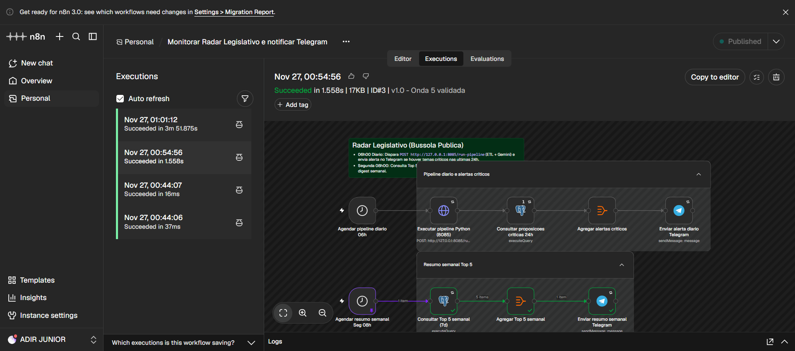

# Radar Legislativo (Bússola Pública)

> Pipeline ponta a ponta de Engenharia de Dados, Modelagem Dimensional, IA Aplicada e Automação para Inteligência Legislativa sobre a API Dados Abertos da Câmara dos Deputados.

---

## 1. Contexto de Negócio

A consultoria **Bússola Pública** entrega inteligência legislativa semanal para escritórios de advocacia, áreas de Relações Governamentais e associações setoriais. Antes deste projeto, a operação sofria com 5 gargalos críticos:

1. Coletas manuais dispersas em planilhas locais.
2. Ausência de histórico estruturado de proposições, votações e despesas.
3. Classificação temática subjetiva e inconsistente entre analistas.
4. Alertas críticos dependentes de memória humana.
5. Falta de visibilidade quantitativa sobre volume legislativo e gastos parlamentares.

O **Radar Legislativo** resolve esses 5 pontos com ingestão resiliente em Python, armazenamento em Data Warehouse dimensional na nuvem (Supabase PostgreSQL 17 + `pgvector`), classificação temática por embeddings com resumo executivo via IA (Gemini Free Tier / OpenAI) e orquestração automatizada no n8n com entregas no Telegram.

---

## 2. Arquitetura do Pipeline


```text
API Camara v2 (/partidos, /deputados, /proposicoes, /votacoes, /despesas)
   |
   v
[Extracao Resiliente - src/extract.py]
   - Paginacao via link rel="next" + retry/backoff exponencial (HTTP 429/5xx)
   - Checkpoint retomavel por deputado + persistencia em data/raw/<entidade>/<data>.json
   |
   v
[Transformacao & Qualidade - src/transform.py]
   - Normalizacao Pandas (pd.json_normalize) + deduplicacao por chave unica
   - Quarentena explicita de despesas negativas (valorLiquido < 0) e validacao de datas
   |
   v
[Data Warehouse Cloud - Supabase PostgreSQL 17.12 + pgvector]
   - Star Schema: dim_partidos, dim_deputados, fato_proposicoes, fato_votacoes, fato_despesas
   - Carga idempotente (INSERT ... ON CONFLICT DO UPDATE) + tabela log_execucoes_pipeline
   |
   v
[Camada de IA - src/ai_enrichment.py]
   - Caminho A: gemini-embedding-001 (1536d L2) ou text-embedding-3-small + cosseno (10 temas em cache)
   - Caminho B: gemini-3.5-flash-lite (ou gpt-4o-mini) para resumo executivo (max 3 linhas)
   |
   v
[Orquestracao n8n - n8n/radar_legislativo_workflow.json + src/webhook_runner.py]
   - Cron diario 06h00 BRT -> Runner HTTP 8085 -> Alerta critico imediato (Telegram HTML)
   - Cron semanal Seg 08h00 BRT -> Digest Top 5 da semana (Telegram HTML)
```

Diagramas Mermaid adicionais em [docs/arquitetura.md](./docs/arquitetura.md).

---

## 3. Modelo Dimensional (Star Schema)

DDL completo e idempotente em [sql/01_schema_star.sql](./sql/01_schema_star.sql) (aplicado no projeto Supabase `radar-legislativo`, `pibefrkcgoplmvkpagda`):

| Tabela | Tipo | Chave Primária | Papel no Modelo | Volume Verificado |
|---|---|---|---|---|
| `dim_partidos` | Dimensão | `id_partido` | Cadastro de partidos políticos ativos | `21` |
| `dim_deputados` | Dimensão | `id_deputado` | Cadastro dos deputados federais (27 UFs), partido e legislatura | `513` |
| `fato_proposicoes` | Fato | `id_proposicao` | Proposições + `tema_ia`, `similaridade_tema`, `resumo_executivo` e `embedding` (`VECTOR(1536)`) | `7.430` (`368` com IA / `80` resumos) |
| `fato_votacoes` | Fato | `id_votacao` | Votações em plenário/comissões e referência lógica `id_proposicao` | `2.004` |
| `fato_despesas` | Fato | `id_despesa` (`uq_despesa_doc`) | Despesas CEAP validadas (`valor_documento >= 0`, `valor_liquido >= 0`) | `1.768` |
| `log_execucoes_pipeline` | Governança | `id_execucao` | Auditoria de registros lidos, rejeitados, carregados, tokens e custo USD | `9` execuções (`US$ 0.00`) |

---

## 4. Decisões Técnicas e Descobertas da API Real

- **Exploração prévia antes do ETL (`src/explore.py` e `notebooks/01_exploracao_api.ipynb`):**
  - Emendas e substitutivos (`SBT`, `EMC`, `PRL`) retornam `ano = 0` na API; o pipeline preserva esses registros em vez de descartá-los erroneamente.
  - Votações recentes frequentemente referenciam proposições protocoladas em anos anteriores; por isso `fato_votacoes.id_proposicao` é indexada sem `FOREIGN KEY` bloqueante.
  - Na coleta completa de **30 dias** (`2026-10-27` a `2026-11-26`), foram extraídos **21 partidos**, **513 deputados**, **7.514 proposições** (`7.430` válidas após filtro de qualidade), **2.000 votações** (subindo para `2.004` na execução diária automatizada) e **20.155 registros de despesas** (**1.768** válidas e **18.387** registros negativos em `valorLiquido` separados em quarentena antes da carga).
- **Resiliência HTTP e IPv4 no Windows:**
  - O endpoint `/deputados/{id}/despesas` aplica limitação de taxa (`HTTP 429`) sob concorrência; o extrator usa `ThreadPoolExecutor`, backoff exponencial e checkpoint local retomável.
  - Em redes Windows com IPv6 sem rota externa, o PostgreSQL do Supabase usa o **Session Pooler IPv4** (`aws-0-sa-east-1.pooler.supabase.com:5432`) e o n8n local inicia com `NODE_OPTIONS="--dns-result-order=ipv4first"` para conexão instantânea com `api.telegram.org`.

---

## 5. Camada de IA e Controle de Custos

- **Provedor ativo e fallback:** `src/ai_enrichment.py` suporta `AI_PROVIDER=gemini` (padrão executado no projeto via SDK `google-genai`, com `gemini-embedding-001` em 1.536 dimensões normalizadas e `gemini-3.5-flash-lite` com fallback e retry automático para `429`) ou `AI_PROVIDER=openai` (`text-embedding-3-small` + `gpt-4o-mini`).
- **Taxonomia Oficial (10 Temas):** Saúde Pública; Sistema Tributário e Fiscal; Trabalho e Previdência; Tecnologia, Dados e Inteligência Artificial; Meio Ambiente, Energia e Clima; Economia, Mercado Financeiro e Regulação; Segurança Pública e Justiça; Educação, Ciência e Cultura; Infraestrutura, Transportes e Cidades; Agronegócio e Desenvolvimento Regional.
- **Prompt do Resumo Executivo (com trava anti-alucinação):**
  > "Voce e um analista senior de inteligencia legislativa da consultoria Bussola Publica. Resuma a proposicao legislativa abaixo em NO MAXIMO 3 linhas, usando portugues claro de negocios (nao juridiques), destacando impacto regulatorio, setor afetado e risco ou oportunidade para empresas."
- **Controle Financeiro Real:** Cache local dos embeddings dos 10 temas em [data/cache/temas_embeddings.json](./data/cache/temas_embeddings.json), seleção incremental apenas onde `tema_ia IS NULL` e piloto obrigatório com `--limit 10`. Execução no Gemini Free Tier somou **368 proposições classificadas** (`100%` dos `PL`, `PLP`, `PEC` e `MPV` da janela) e **80 resumos executivos** a custo **US$ 0.00**.

---

## 6. Evidências de Automação (n8n + Telegram)

### Canvas do Workflow Publicado (`Pbtgkim2DNO5Hgc0`)


### Execução Diária (`ID#4`, Runner 8085 + Supabase + Gemini + 10 Alertas Críticos) e Semanal (`ID#3`, Top 5)
| Execução Diária (`3m 51.875s`) | Execução Semanal Top 5 (`1.558s`) |
|---|---|
|  |  |

### Mensagens Recebidas em Tempo Real no Telegram (`@radar_legislativo_22005bot`)


---

## 7. Como Executar

### Pré-requisitos
- Python 3.11+ e Node.js 18+ (para `npx n8n`)
- Projeto PostgreSQL no Supabase (com extensão `pgvector`)
- Chave da Google Gemini API (`GEMINI_API_KEY`) ou OpenAI (`OPENAI_API_KEY`)

### Instalação e Configuração
```powershell
python -m venv .venv
.\.venv\Scripts\activate
pip install -r requirements.txt
copy .env.example .env
# Preencha DATABASE_URL, AI_PROVIDER=gemini e GEMINI_API_KEY (ou OPENAI_API_KEY) no arquivo .env
python src\check_env.py
```

### Execução do Pipeline
```powershell
# 1. Exploracao da API (Onda 1)
python -m src.explore

# 2. Pipeline completo piloto de 7 dias (sem IA caso ainda nao tenha chave configurada)
python -m src.main --step all --days 7 --skip-ai

# 3. Carga oficial de 30 dias (Onda 3)
python -m src.main --step extract --days 30
python -m src.main --step load --days 30

# 4. Piloto obrigatorio de IA com 10 proposicoes e lote incremental (Onda 4)
python -m src.main --step ai --limit 10
python -m src.main --step ai --limit 50
```

---

## 8. Acesso e Consultas de Leitura no Supabase

O Data Warehouse está hospedado no Supabase (`https://pibefrkcgoplmvkpagda.supabase.co`, região `sa-east-1`), acessível via **Supabase Table Editor / SQL Editor** ou via **Session Pooler PostgreSQL** (`aws-0-sa-east-1.pooler.supabase.com:5432`, usuário `postgres.pibefrkcgoplmvkpagda`, SSL habilitado).

Consultas prontas para validação pela banca ou conexão de BI (Power BI / Streamlit):

```sql
-- 1. Auditoria de volume por tabela
SELECT 'dim_partidos' AS tabela, COUNT(1) AS total FROM public.dim_partidos
UNION ALL SELECT 'dim_deputados', COUNT(1) FROM public.dim_deputados
UNION ALL SELECT 'fato_proposicoes', COUNT(1) FROM public.fato_proposicoes
UNION ALL SELECT 'fato_votacoes', COUNT(1) FROM public.fato_votacoes
UNION ALL SELECT 'fato_despesas', COUNT(1) FROM public.fato_despesas
UNION ALL SELECT 'log_execucoes_pipeline', COUNT(1) FROM public.log_execucoes_pipeline;

-- 2. Top proposicoes classificadas em temas criticos com resumo executivo
SELECT id_proposicao
  , sigla_tipo
  , numero
  , ano
  , tema_ia
  , similaridade_tema
  , resumo_executivo
  , data_apresentacao
FROM public.fato_proposicoes
WHERE tema_ia IS NOT NULL
  AND resumo_executivo IS NOT NULL
ORDER BY similaridade_tema DESC
LIMIT 10;

-- 3. Ranking de despesas CEAP por UF e partido
SELECT d.sigla_uf
  , d.sigla_partido
  , COUNT(f.id_despesa) AS qtd_lancamentos
  , ROUND(SUM(f.valor_liquido), 2) AS total_liquido_brl
FROM public.fato_despesas f
JOIN public.dim_deputados d ON d.id_deputado = f.id_deputado
GROUP BY d.sigla_uf
  , d.sigla_partido
ORDER BY total_liquido_brl DESC
LIMIT 15;
```

---

## 9. Automação n8n e Pitch Executivo

- Workflow publicado e exportado (sanitizado) em [n8n/radar_legislativo_workflow.json](./n8n/radar_legislativo_workflow.json) com guia completo em [n8n/README.md](./n8n/README.md).
- Runner HTTP local (stdlib) para acionamento pelo n8n: `python -m src.webhook_runner` (`GET /health`, `POST /run-pipeline`).
- Apresentação executiva (6 slides): roteiro em [docs/pitch_bussola_publica.md](./docs/pitch_bussola_publica.md) e deck final em [docs/pitch_bussola_publica.pdf](./docs/pitch_bussola_publica.pdf).
