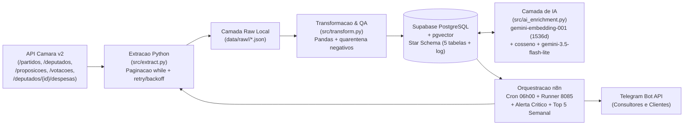
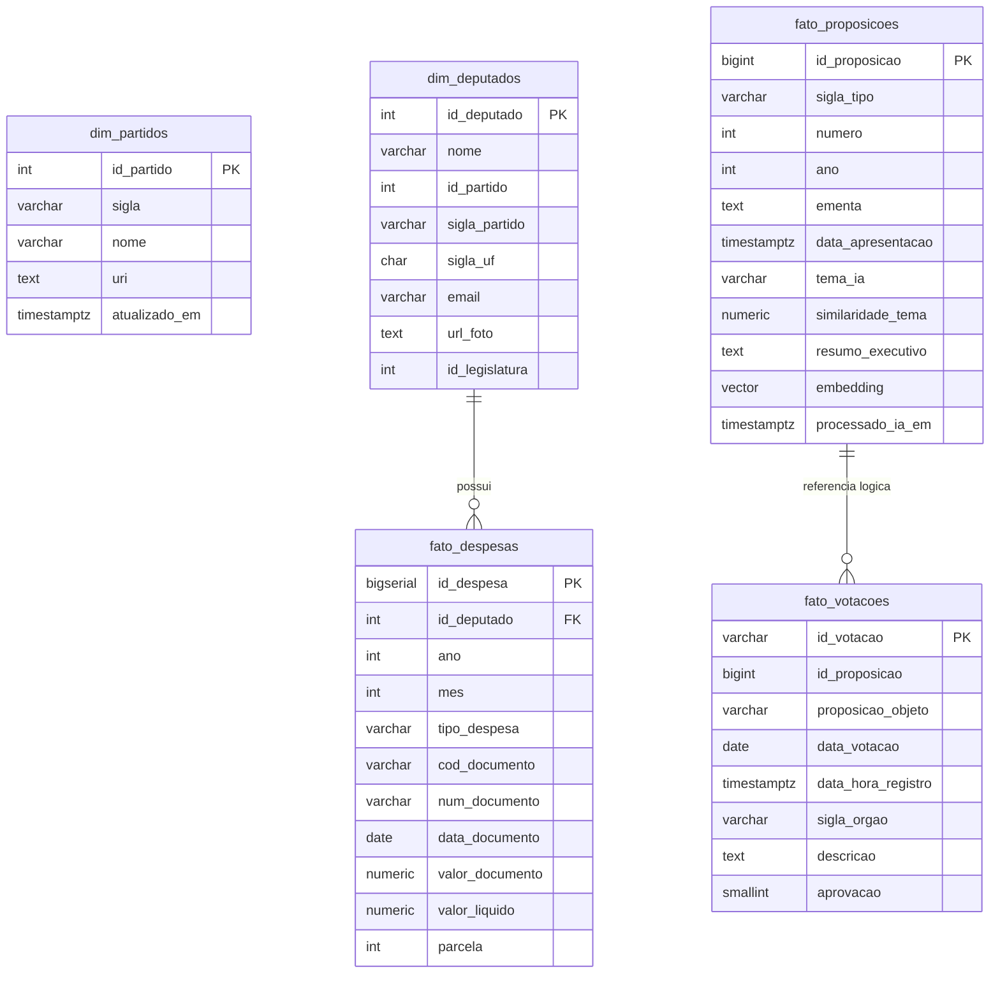

# Arquitetura do Pipeline - Radar Legislativo (Bússola Pública)

## 1. Fluxo Ponta a Ponta

## 2. Modelo Dimensional (Star Schema)

> Para exportar `docs/arquitetura.png`, renderize os diagramas acima via Mermaid CLI (`mmdc`) ou [mermaid.live](https://mermaid.live) e salve a imagem em `docs/arquitetura.png`.
